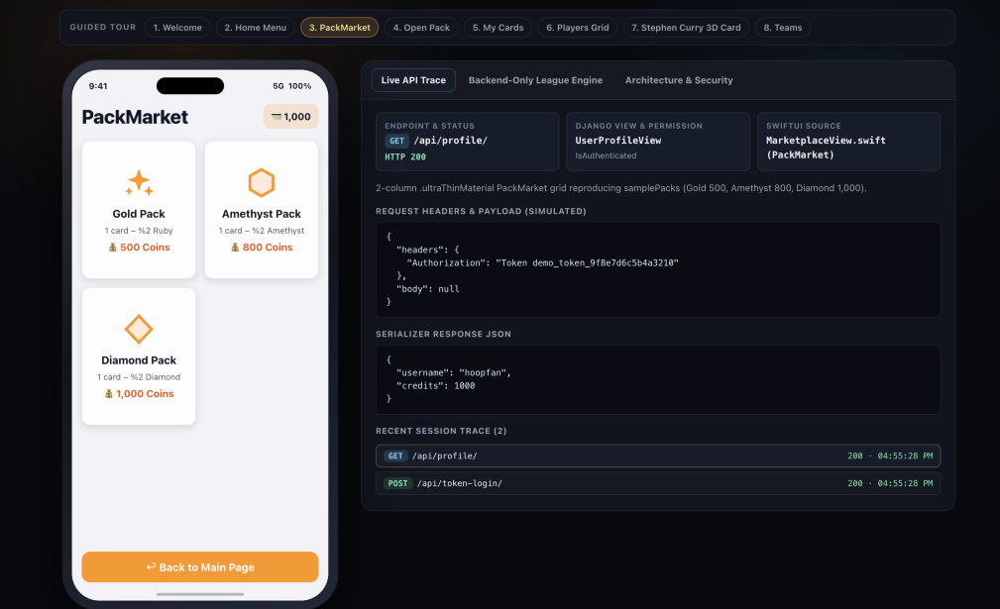

# Ertürk Eryavuz

**Computer Engineer · AI Engineering, LLM/RAG Systems, AI Agents & Python Backend**

Building local-first LLM/RAG pipelines, governed AI agent runtimes, and inspectable Python backend systems.

  &nbsp;&nbsp;
  &nbsp;&nbsp;
  

[Featured Projects](#featured-projects) · [Technical Expertise](#technical-expertise) · [More Projects](#more-projects) · [Background and Contact](#background-and-contact)

---

## About Me

- 🎓 **Computer Engineering graduate** (Maltepe University, 2025) based in **Istanbul, Turkey**.
- 🧠 Focusing on **AI Engineering**, **LLM/RAG retrieval and evaluation**, **agent orchestration**, and **Python backend development**.
- 🛠️ Engineering **local-first, inspectable systems** around explicit authorization gates, citation-grounded answers, deterministic validation, and candid reporting of model limitations.
- 🎯 Exploring **Junior / Early-Career AI Engineering, LLM/RAG, Agent Systems, and Python Backend** opportunities.

---

## Featured Projects

> My three flagship AI engineering systems (**QUO**, **RAG Platform**, and **AI Enterprise Automation**) are private local-first repositories presented through **public, self-contained interactive showcases** on GitHub Pages. Each live site replays real recorded backend runs over synthetic or public benchmark data — with **no live browser-side inference and no external backend connection** — so reviewers can inspect plans, retrieval rankings, approval gates, provenance records, and failure modes directly. **Fantasy Basketball** is a public full-stack graduation project with a live interactive showcase.

### 1. QUO · Conductor — Local AI Orchestration Runtime

**[Open Live Showcase →](https://erturkeryavuz.github.io/quo-conductor-demo/)** · [Public Demo Repository](https://github.com/erturkeryavuz/quo-conductor-demo) · `Private Source · Static Replay Showcase (8 Recorded Runs)`

- **Plan-then-execute orchestration:** Routes direct questions immediately and decomposes tool-requiring tasks into dependency-ordered plans where each step runs through a declared capability with an effect class, permission policy, and time budget.
- **Mandatory write authorization:** Read-only capabilities execute by policy, while workspace writes pause for explicit approval bound to the exact action digest; refusals and mid-run cancellations halt execution without invoking the tool.
- **Inspectable execution journal:** Reconstructs the interface, timeline, telemetry, and full payload log from a durable journal while candidly documenting small local-model (`llama3.2:3b`) answer mistakes and scripted-client approval playback.
- **Core stack:** Python · Local LLMs (`Ollama` / `llama3.2:3b`) · Capability-Scoped Tool Execution · Approval Gates · Durable Journaling

---

### 2. RAG Platform · Evidence Desk — Hybrid Retrieval & Cited Generation

**[Open Live Showcase →](https://erturkeryavuz.github.io/rag-evidence-desk-demo/)** · [Public Demo Repository](https://github.com/erturkeryavuz/rag-evidence-desk-demo) · `Private Source · Static Replay Showcase (Synthetic Corpus & Benchmarks)`

- **Hybrid retrieval with Reciprocal Rank Fusion:** Combines dense embeddings (`multilingual-e5-small`) and BM25 lexical search so both semantic queries and exact error codes (such as `PW-4107`) surface in the top-five context window.
- **Citation tracing & refusal discipline:** Links every citation marker to the exact passage provided to the model, pairs deterministic marker-resolution checks with manual groundedness review, and refuses questions unsupported by the corpus.
- **Empirical reranker evaluation:** Benchmarked an optional cross-encoder reranker (`ms-marco-MiniLM-L-6-v2`) across labelled English (20 questions) and Turkish (21 questions) sets — keeping it disabled by default after measuring lower Recall@1 and higher latency, and publishing reviewed 3B-model failure cases openly.
- **Core stack:** Python · Dense Embeddings (`multilingual-e5-small`) · BM25 & RRF · Cross-Encoder Evaluation · Local `Ollama` (`llama3.2:3b`) · 2D PCA Corpus View

---

### 3. AI Enterprise Automation · Ledger — Governed Workflows & File Provenance

**[Open Live Showcase →](https://erturkeryavuz.github.io/aiea-ledger-demo/)** · [Public Demo Repository](https://github.com/erturkeryavuz/aiea-ledger-demo) · `Private Source · Static Replay Showcase (26 Recorded Scenarios)`

- **Strict pre-execution validation:** Rejects unknown keys or tools, duplicate IDs, dependency cycles, dangling references, and oversized requests before any step starts, then executes valid steps deterministically one at a time in dependency order.
- **Authorization & process isolation:** Blocks unapproved high-risk writes across both interactive terminal prompts and JSON contract mode, executes each tool in a separate subprocess with an empty environment, and supports idempotent replay of identical requests.
- **SQLite provenance & drift detection:** Records run history and SHA-256 artifact manifests so `verify`, `inspect`, and `prune` detect external file tampering (`content_mismatch`), missing/untracked files, and superseded revisions across 41 recorded CLI commands (CLI-only, 5-tool catalog, local approval scope).
- **Core stack:** Python CLI Runtime · DAG & Schema Validation · Authorization Gates · Subprocess Isolation · SQLite SHA-256 Provenance

---

### 4. Fantasy Basketball Platform — Full-Stack Django DRF & SwiftUI Application

**[Open Live Showcase →](https://erturkeryavuz.github.io/fantasy-basketball/)** · [Public Source Repository](https://github.com/erturkeryavuz/fantasy-basketball) · `Public Source · Interactive Phone-Framed Showcase`

- **Full-stack graduation project (Maltepe University):** Combines a **Django 5 + Django REST Framework** API backend with a native **SwiftUI** iOS client, verified by an automated backend API regression suite.
- **End-to-end iOS & API workflows:** Implements token-authenticated registration/login, team and club rosters, a 4-filter player directory, six auto-assigned rarity tiers (`Gold` through `DarkBlueDiamond`), atomic credit-based `PackMarket` pack opening (`POST /api/open-pack/`), and a personal `My Cards` inventory.
- **Relational league engine & static showcase:** Includes staff-gated backend REST endpoints for 10-player leagues, round-robin schedules, match results, and standings (backend-only, not yet wired in SwiftUI), paired with a browser-only static showcase displaying live matching serializer traces and [third-party photo notices](https://erturkeryavuz.github.io/fantasy-basketball/notices.html).
- **Core stack:** Python · Django 5 · Django REST Framework · SQLite · Swift · SwiftUI · HTML5 / CSS3 / ES Modules

---

## Technical Expertise

### AI & LLM Systems

  &nbsp;
  &nbsp;
  &nbsp;
  

Local LLMs (`Ollama`), Hybrid RAG (Dense Embeddings, BM25, Reciprocal Rank Fusion, Cross-Encoder Reranking), Groundedness & Retrieval Evaluation, TensorFlow / Keras, `scikit-learn`

### Agents & Orchestration

  &nbsp;
  &nbsp;
  &nbsp;
  

Plan-Then-Execute DAG Workflows, Capability & Permission Policies, Human-in-the-Loop Approval Gates, Durable Execution Journaling, Subprocess Boundaries, SHA-256 Artifact Provenance

### Backend, APIs & Data

  &nbsp;
  &nbsp;
  &nbsp;
  &nbsp;
  

Python, FastAPI, Django & Django REST Framework, REST API Design, SQLite, PostgreSQL, MySQL, `pandas`, `NumPy`

### Mobile & Web Interfaces

  &nbsp;
  &nbsp;
  &nbsp;
  

Swift, SwiftUI, Firebase (Authentication, Cloud Firestore, Storage), TypeScript, JavaScript, React, HTML5 / CSS3

### Engineering & Verification

  &nbsp;
  &nbsp;
  &nbsp;
  

Git, GitHub Actions CI, `pytest` & `unittest`, Deterministic Schema Validation, Security Remediation (SQLi/CSRF/XSS/IDOR), Procedural PHP

---

## More Projects

#### [TSLAIQ](https://github.com/erturkeryavuz/TSLAIQ) · [Live Research Showcase →](https://erturkeryavuz.github.io/TSLAIQ/)
Historical `TSLA` time-series analytics and Keras sequence-modeling pipeline across 15 years of daily OHLCV data (`2010-06-29` to `2025-06-05`, `3,758` trading days) with RSI, EMA20, EMA50, MACD, and OBV indicators, leak-free chronological preprocessing, and a dark interactive analytics showcase.  
*Scope & honesty note:* Educational research only (not live market data or investment advice). In the reported evaluation, historical logged LSTM checkpoints did not outperform the naive persistence baseline (`$9.68–$9.69` USD RMSE), and fresh TensorFlow/Keras runtime retraining was not verified on the offline test host.  
**Stack:** Python · TensorFlow / Keras · `pandas` · `scikit-learn` · `yfinance` · HTML5 / CSS3 / JS

#### [Euro2024App](https://github.com/erturkeryavuz/Euro2024App) · [Live Interactive Showcase →](https://erturkeryavuz.github.io/Euro2024App/)
Native SwiftUI and Firebase iOS football companion featuring match timelines, unified standings, 20 national teams, a filterable 220-player directory, user profiles, and a Python Firestore seeding script — paired with a phone-framed static web showcase.  
*Scope & honesty note:* Built over a static bundled sample dataset (2020/2021-era squads and synthetic demonstration fixtures), not live or official UEFA Euro 2024 tournament data.  
**Stack:** Swift · SwiftUI · Firebase (Auth, Firestore, Storage) · Python · HTML5 / CSS3 / ES Modules

#### [NBASHOP](https://github.com/erturkeryavuz/NBASHOP) · [Live Storefront Showcase →](https://erturkeryavuz.github.io/NBASHOP/)
Legacy procedural PHP/MySQL e-commerce storefront and admin panel refactored for security across all 46 PHP files (prepared statements, `password_verify`, CSRF/XSS/IDOR protections, safe image upload validation, and Apache `.htaccess` guards — passing `17/17` PHP 8.3 / MySQL 8.0 / Apache 2.4 CI runtime security tests), paired with a synthetic static storefront showcase.  
*Scope & honesty note:* Runs strictly in non-payment order-preview mode (no live payment processing) and is not affiliated with or endorsed by the NBA or any commercial sports brand.  
**Stack:** PHP · MySQL · GitHub Actions CI · Apache 2.4 · HTML5 / CSS3 / JS

#### Trading Edge Terminal · [Live Research Showcase →](https://erturkeryavuz.github.io/trading-edge-terminal-demo/) · [Public Demo Repository](https://github.com/erturkeryavuz/trading-edge-terminal-demo) · `Private Source · Frozen`
Historical U.S. financial research workstation combining public-domain SEC EDGAR XBRL fundamentals, U.S. Treasury yield curves, explainable GAAP screening and scoring (`m2u3-accounting-score-v1`), structured risk rules, and a synthetic point-in-time bar-revision replay.  
*Scope & honesty note:* Frozen private engineering project presented via a dated `2026-11-12` historical snapshot and synthetic revision fixture — no live equity prices, brokerage integration, validated profitable strategy, or investment advice.  
**Stack:** Python (stdlib) · SQLite · SEC EDGAR XBRL · U.S. Treasury CSV · HTML5 / CSS3 / SVG / JS

#### GoSil · [Live Research Showcase →](https://erturkeryavuz.github.io/gosil-analytics-demo/) · [Public Demo Repository](https://github.com/erturkeryavuz/gosil-analytics-demo) · `Private Source · Frozen`
Precious-metals accounting and statistical research platform demonstrating exact fixed-point integer math (`e4` TRY / `ug` mass), 6-tier price separation, exact `31.1034768` g/oz currency decomposition, `900s` spread/freshness gates, and purged walk-forward baseline evaluation.  
*Scope & honesty note:* Frozen private engineering project presented as a 100% synthetic showcase — no live prices, real personal financial data, LLM forecasting engine, or reliable future-price prediction claims.  
**Stack:** Python · SQLite (`STRICT`) · Fixed-Point / `Fraction` Math · Walk-Forward Statistics · HTML5 / CSS3 / SVG / JS

---

## Background and Contact

- **Education:** B.Sc. in Computer Engineering, **Maltepe University** (2025)
- **Project Boundary:** All featured and supporting showcases above represent independent personal or academic engineering projects; private AI and frozen financial-research source repositories remain private while their verified behavior and limitations are shared through public static showcases.
- **Availability:** Open to **Junior / Early-Career AI Engineering, LLM/RAG, Agent Systems, and Python Backend** roles.

**Connect:** [LinkedIn](https://www.linkedin.com/in/erturkeryavuz) · [erturkeryavuz@gmail.com](mailto:erturkeryavuz@gmail.com) · [GitHub](https://github.com/erturkeryavuz)
